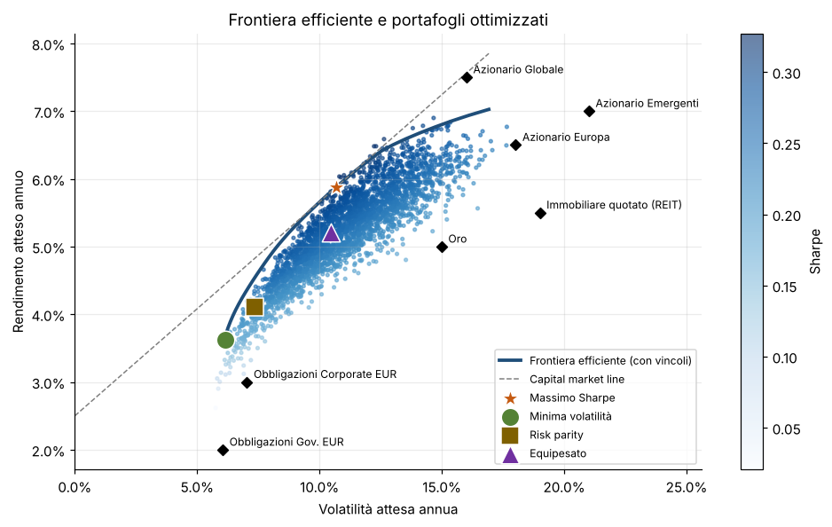
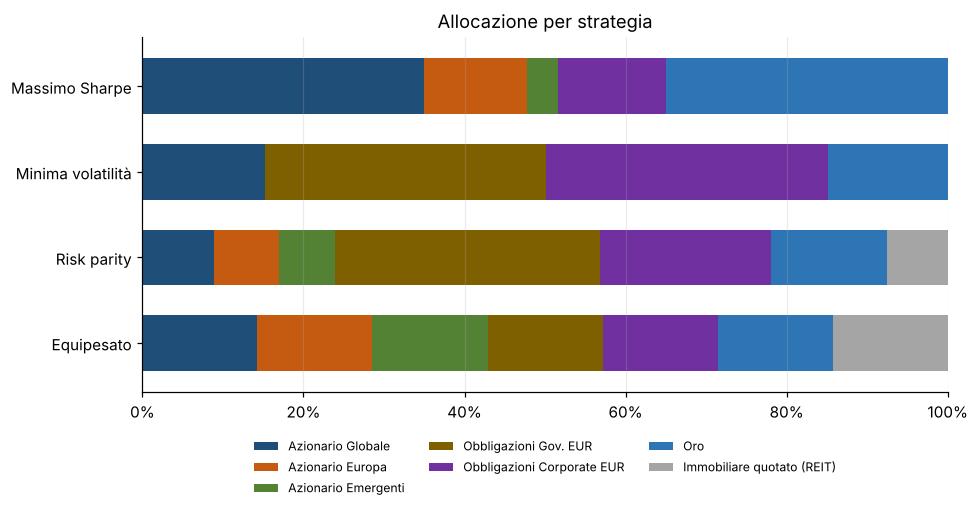
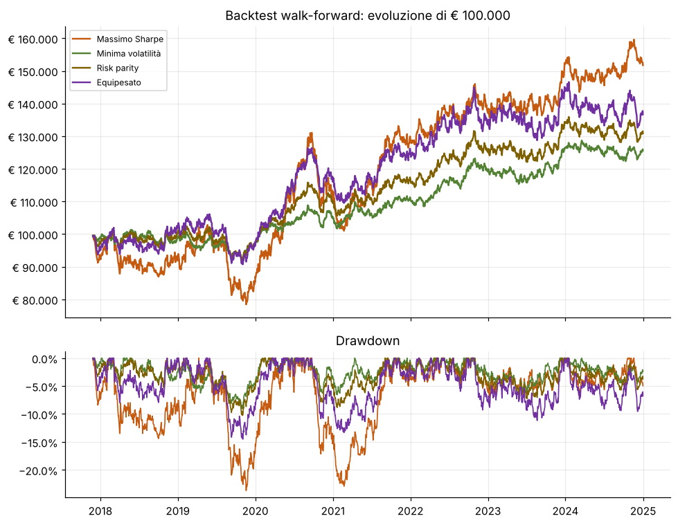

# Portfolio Optimizer

**Analisi e ottimizzazione di portafoglio per la gestione patrimoniale, in Python.**

Dato lo storico dei prezzi di un insieme di strumenti (ETF, fondi, azioni, asset class), il progetto
stima rischio e rendimento, costruisce i portafogli ottimali secondo diversi approcci, li verifica
con un backtest senza "senno di poi" e produce un **report HTML pronto da consegnare al cliente**.



## Cosa fa

| Area | Contenuto |
|---|---|
| **Metriche** | CAGR, volatilità, Sharpe, Sortino, drawdown massimo, VaR e CVaR storici |
| **Stima del rischio** | Covarianza con shrinkage di Ledoit-Wolf, più stabile della stima campionaria |
| **Ottimizzazione** | Massimo Sharpe, minima volatilità, rendimento obiettivo, frontiera efficiente (Markowitz), risk parity |
| **Vincoli** | Peso minimo e massimo per asset (es. "almeno 20% obbligazionario", "oro al massimo 10%") |
| **Backtest** | Walk-forward: ribilanciamento trimestrale su finestra di 3 anni, con costi di transazione |
| **Report** | HTML autonomo in italiano: allocazione in euro, contributi al rischio, confronto strategie, grafici |

Il motore di ottimizzazione è scritto da zero su `scipy.optimize`, senza librerie "a scatola chiusa",
così ogni passaggio è verificabile e personalizzabile.

## Avvio rapido

```bash
git clone https://github.com/<tuo-utente>/portfolio-optimizer.git
cd portfolio-optimizer
pip install -e ".[yahoo]"

# Report con dati dimostrativi
portfolio-optimizer --demo --cliente "Mario Rossi" --importo 250000

# Report con dati reali da Yahoo Finance (ETF quotati in Europa)
portfolio-optimizer --ticker VWCE.DE EUNA.DE SGLD.MI IWDP.MI --da 2016-01-01 --max-peso 0.40

# Report da un proprio file di prezzi (colonna data + una colonna per strumento)
portfolio-optimizer --csv data/prezzi_esempio.csv --risk-free 0.03 --grafici output/img
```

Il report viene salvato in `output/report.html`. Un esempio già generato è in
[`docs/report_esempio.html`](docs/report_esempio.html).

## Uso come libreria

```python
from portfolio_optimizer import PortfolioOptimizer, expected_returns, ledoit_wolf_covariance, load_csv
from portfolio_optimizer.metrics import to_returns

returns = to_returns(load_csv("data/prezzi_esempio.csv"))
cov, _ = ledoit_wolf_covariance(returns)

opt = PortfolioOptimizer(
    expected_returns(returns), cov, risk_free=0.025,
    min_weight={"Obbligazioni Gov. EUR": 0.20},   # vincolo del cliente
    max_weight=0.30,
)
best = opt.max_sharpe()
print(best.weights, best.expected_return, best.volatility)
print(opt.risk_contributions(best.weights))      # da dove viene il rischio
```

Esempio completo in [`examples/esempio.py`](examples/esempio.py).

## Risultati sull'esempio dimostrativo

Sette asset class tipiche di un portafoglio privato (azionario globale, Europa, emergenti,
obbligazioni governative e corporate EUR, oro, immobiliare quotato), 10 anni di dati.



Il backtest ricalcola i pesi ogni trimestre usando solo i tre anni precedenti, come avverrebbe nella
realtà, e sottrae 10 punti base di costi su ogni operazione.



## Metodologia in breve

- **Rendimenti attesi**: media storica annualizzata. È la stima più semplice e anche la più rumorosa:
  per questo il report affianca strategie che non dipendono dai rendimenti attesi (minima volatilità,
  risk parity) e il backtest out-of-sample.
- **Covarianza**: shrinkage di Ledoit-Wolf verso una matrice identità scalata, che riduce l'errore di
  stima e i portafogli troppo concentrati.
- **Massimo Sharpe / minima volatilità / rendimento obiettivo**: programmazione quadratica con
  vincoli (SLSQP). Il campo dei rendimenti raggiungibili è calcolato con programmazione lineare.
- **Risk parity**: formulazione convessa `min ½·w'Σw − (1/n)·Σ log wᵢ`, che dà contributi di rischio
  identici per ogni asset.

## Struttura

```
src/portfolio_optimizer/
├── data.py        # CSV, Yahoo Finance, dati dimostrativi
├── metrics.py     # metriche di rendimento e rischio
├── optimize.py    # stime, ottimizzatore, frontiera efficiente
├── backtest.py    # backtest walk-forward con costi
├── report.py      # grafici e report HTML
├── cli.py         # riga di comando
└── templates/     # modello del report
tests/             # 22 test (pytest), eseguiti a ogni push con GitHub Actions
```

## Test

```bash
pip install -e ".[dev]"
pytest
```

I test verificano le formule su casi con soluzione nota (drawdown di un percorso dato, peso di
varianza minima in forma chiusa per due asset, contributi di rischio uguali nella risk parity) e
che il backtest usi solo dati passati.

## Avvertenze

I dati in `data/prezzi_esempio.csv` sono **sintetici**, generati per illustrare il funzionamento, e non
rappresentano alcuno strumento reale. Il progetto ha scopo dimostrativo e non costituisce consulenza
finanziaria: i rendimenti passati non sono indicativi di quelli futuri.

## Licenza

MIT. Autore: Francesco Torraco.
